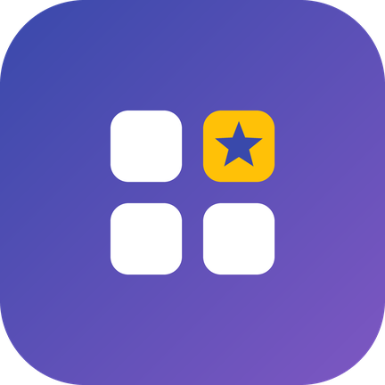
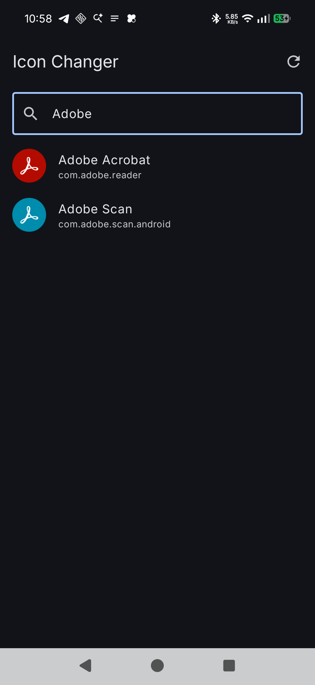
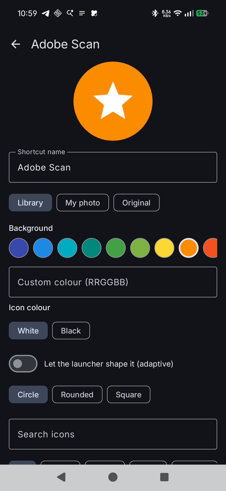
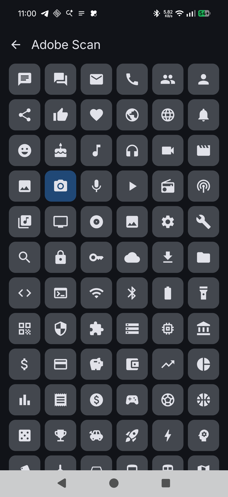
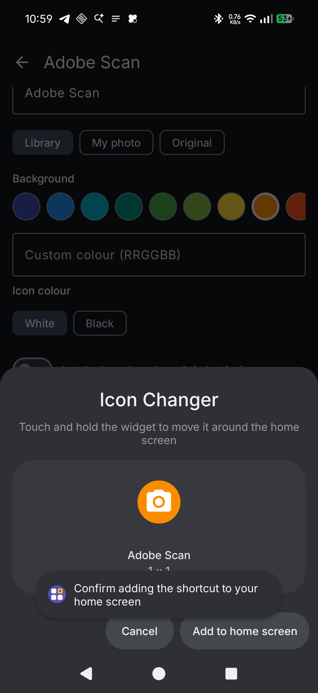
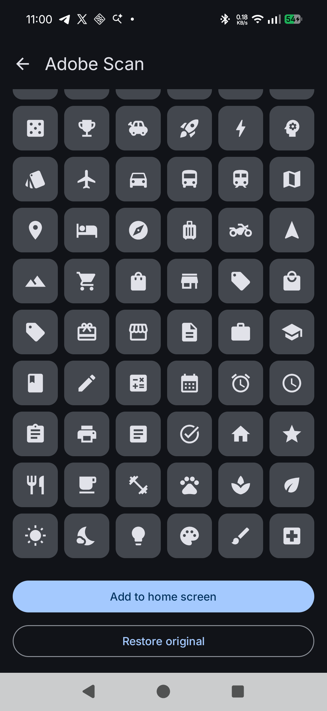
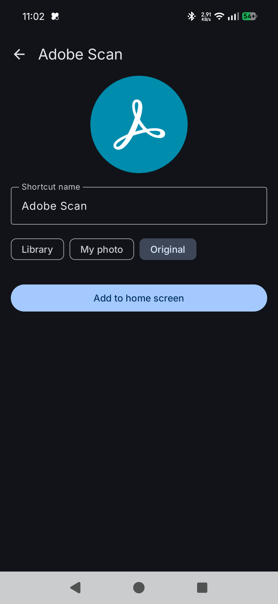

<p align="center">
  
</p>

# Icon Changer

> **Disclaimer.** This app is provided **AS IS**, without warranty of any kind, express or
> implied. Use it entirely at your own risk. The author accepts no liability for data loss,
> lost shortcuts or home-screen layouts, device problems, business interruption, or any
> consequential damage. You are responsible for checking what you change on your phone and
> for being allowed to change it. It is not a parental-control or security product and is not
> certified for any regulated or safety-critical use. The [LICENSE](LICENSE) (MIT) is the
> governing text and prevails wherever this summary differs from it.

An Android app that lists the apps on your phone and lets you give any of them a new icon
and name on your home screen. Pick one of about 110 built-in icons, or use your own photo,
and the original is always kept so you can restore it later.

## How it works, and its limit

Android does not allow one app to change another app's real launcher icon. That icon lives
inside the other app's signed package. So, like every icon changer, this app **creates a
pinned home-screen shortcut** that opens the app with the icon and name you chose.

- The original icon stays in the app drawer, untouched.
- You remove the old home-screen icon yourself if you do not want both.
- Some launchers add a small badge to shortcuts.
- Your launcher must support pinned shortcuts. If it does not, the app says so.

## Use case: a phone shared with kids

Bright, familiar icons such as YouTube and Instagram pull young children in. On a phone the
family shares, you can make those apps less eye-catching, or easier for a child to recognise:

- **Tone them down:** give YouTube and Instagram a plain grey tile (type `9E9E9E` in the
  custom colour field, or pick the blue-grey swatch) with a neutral glyph such as the
  briefcase or the lock, and a dull name such as "Work". Then remove the original icon from
  the home screen (long-press it, Remove), so only the toned-down one is left there.
- **Make kids' apps easy to find:** give a learning or drawing app a bright colour and a
  friendly icon (a star, a palette, a book), and a name your child can read.
- **Undo any time:** open the app again and tap **Restore original** to go back to the real
  icon and name.

Keep in mind that this changes how the apps **look**, not what can be opened. The real icons
stay in the app drawer and in search, and an older child will find them. To actually block an
app, set a time limit or require a parent's approval, use your phone's parental controls
(Google Family Link, or Digital Wellbeing's app timers).

## Screenshots

| App list | Editor | Icon collection |
|---|---|---|
|  |  |  |

| Add to home screen | Restore | Original icon |
|---|---|---|
|  |  |  |

## Usage

1. Open the app and find the one you want to change (the search box filters by name or package).
2. Choose where the icon comes from:
   - **Library**: pick an icon, a background colour (or type your own `RRGGBB`), white or
     black artwork, and a shape (circle, rounded, square). Search by name or filter by category.
   - **My photo**: choose an image, then drag and pinch the preview to crop it. Camera photos\n     keep their orientation.
   - **Original**: the app's own icon, saved the first time you open it here.
3. Edit the shortcut name if you like, then tap **Add to home screen** and confirm in your
   launcher.
4. Change your mind later: open the app again. Your last choice is remembered, so you can
   adjust it, and re-applying **updates the same shortcut** rather than adding a second one.
5. If your launcher cannot pin shortcuts, nothing is saved, so the app is not marked as changed.\n6. **Restore original** puts a pinned shortcut back to the app's own icon and name and clears
   the saved customisation. The app's real icon in the app drawer was never changed.

The **adaptive** switch hands shaping to the launcher, so the icon follows your theme's
mask. Leave it off to keep the exact shape you picked.

## Privacy

Everything stays on the phone. There is no network access and no account. The only
permissions are the ability to see launchable apps (a package visibility query, not the broad
"all packages" permission) and, for photos, the system Photo Picker, which gives the app
only the image you choose. Picked photos and saved original icons are kept in the app's own
storage. When an app they belong to has been uninstalled, they are cleaned up the next time\nthis app opens.

## Build

Requirements: JDK 17 and the Android SDK (compileSdk 35, minSdk 26).

```powershell
.\gradlew.bat :app:assembleDebug :app:testDebugUnitTest
.\gradlew.bat :app:installDebug
```

A signed release build reads its key from a `keystore.properties` file (gitignored):

```properties
storeFile=C:/path/to/key.p12
storePassword=...
keyAlias=...
keyPassword=...
```

```powershell
.\gradlew.bat :app:assembleRelease
```

The APK is written to pp/build/outputs/apk/release/com.pandiyarajk.iconchanger.apk, named\nafter the applicationId. Without keystore.properties the release build is produced unsigned.

## Project layout

| Path | What it holds |
|---|---|
| `apps/` | Lists launchable apps (`AppRepository`) |
| `icons/` | `IconCatalog` (the built-in collection), `IconRenderer` (draws an icon to a bitmap), `IconGeometry` (shape and crop maths), `IconSpec` |
| `shortcut/` | `ShortcutCreator` pins, updates and restores shortcuts. One fixed id per app, so edits never duplicate |
| `data/` | `HistoryStore`, the saved choices (DataStore), pruned when an app is uninstalled |
| `ui/` | Compose screens and `MainViewModel` |

Kotlin, Jetpack Compose and Material 3, with manual wiring: no Hilt, no Room, no navigation
library.

## Credits

The built-in icons are Material icons from the Compose `material-icons-extended` library,
licensed under the Apache License 2.0.

## License

MIT, see [LICENSE](LICENSE). Provided as is, without warranty. This is a personal project
and has not been tested on every launcher.
